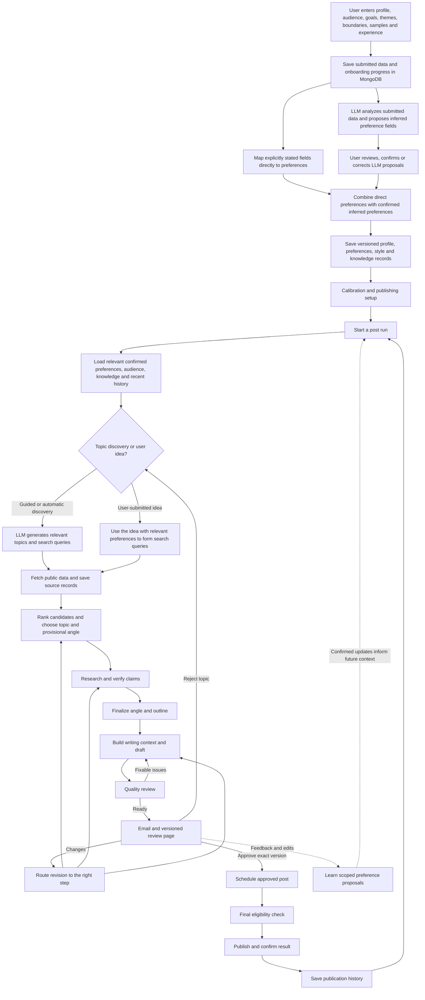

# LinkedIn post system - complete workflow

Planning companion to [Phase 0 product definition](phase-0-product-definition.md), version 1.1.

This document explains the existing simplified scope from first onboarding to publication and the next post. It does not add GitHub integration, personal-account mining, media generation, engagement automation, or audience analytics. MongoDB remains the database. No application code is implemented by this document.

## 1. The complete idea

The user supplies personal context at the start. The system uses that context to choose relevant subjects, develop arguments the user can support, write in their voice, and send finished drafts for review. The user approves or requests changes. Only the approved version is scheduled and published. Feedback improves future drafts.

There are three connected loops:

1. **Initial setup:** learn who the user is, how they write, what they believe, and what they have actually experienced.
2. **Post production:** select an idea, research it, develop it, write it, check it, obtain approval, and publish it.
3. **Learning:** use explicit feedback and revisions to improve the saved profile and style used in later posts.

Learning here means updating useful, traceable profile and memory records. It does not require retraining or fine-tuning the language model.

The diagram shows the intake-to-publication path. User-stated preference fields are mapped directly from submitted data; preference fields inferred by the LLM remain proposals until confirmed or corrected. Both are saved with their source and profile version in MongoDB. For each run, the LLM uses only relevant confirmed preferences (plus any current instructions or user idea) to produce topics and search queries; retrieved public data is saved as sources before the existing research and writing workflow continues. Factual or privacy blockers stop publication; the detailed rules below determine whether to revise, ask for information, hold, or abandon the post. The next run starts only according to the user's chosen cadence or an explicit request, not immediately after every publication.

## 2. What personalization consists of

| Personal context | Question it answers | Example of its influence |
|---|---|---|
| Identity and expertise | Who are you, and what can you credibly discuss? | Writes as someone learning a tool instead of claiming expert production experience |
| Audience and goals | Who is this for, and why are you posting? | Explains implementation tradeoffs to engineers rather than giving a beginner definition |
| Style card | How do you normally express ideas? | Uses direct paragraphs, familiar technical language, and restrained conclusions |
| Writing examples | What does your voice look like in real text? | Matches your rhythm and explanation style without copying whole sentences |
| Stances | What do you actually think, and under what conditions? | Preserves your conditional support for an approach rather than making a blanket attack |
| Experiences | What happened to you, and what was your role? | Uses a real debugging lesson with the correct attribution |
| Publication history | What have you already said and how did you say it? | Avoids repeating last week's argument with a new opening |
| Feedback | What have you corrected or explicitly requested? | Carries a confirmed preference for fewer rhetorical questions into later posts |

These layers work together. Style alone cannot supply an authentic opinion or a real experience. Research supplies external evidence; it does not establish the user's biography.

Instruction priority is: current post instructions, explicit saved preferences, confirmed learned preferences, then tentative suggestions. Factual accuracy and disclosure boundaries still apply at every level. A request for a more dramatic post is not permission to invent a story.

## 3. What the user does and what the system does

| Moment | User responsibility | System responsibility |
|---|---|---|
| Onboarding | Supply and confirm profile, samples, views, experiences, and boundaries | Organize inputs, propose the style card, identify gaps, save confirmed information |
| Guided mode | Choose a proposed topic; optionally specify angle and depth | Discover, rank, and explain candidates |
| Automatic mode | Enable the mode after calibration; review finished drafts | Select a suitable topic and angle |
| User idea mode | Submit a thought, question, topic, note, or link | Develop the idea into a supported post |
| Research through quality review | Usually no action | Research, outline, write, and check the draft |
| Essential missing information | Answer a targeted question if the post depends on it | First try omitting or reframing unsupported details |
| Draft review | Approve, edit, request changes, reject, or postpone | Display exact draft and sources, route feedback, preserve versions |
| Scheduling and publishing | Choose the allowed schedule and approve the post | Publish the approved payload at an eligible time and record the result |
| Learning | State lasting preferences or confirm useful inferred ones during normal review | Interpret feedback by scope, save evidence, update future context |

The user does not approve every internal outline or research step. Normal ongoing involvement is final-draft review. Guided topic choice and essential factual questions are the explicit exceptions.

## 4. Initial onboarding: done once, improved later

### Step 0A. Collect identity, audience, goals, and boundaries

**User supplies:** current role, actual areas of experience, learning interests, desired public positioning, intended audience, content themes, language, timezone, and anything that should remain private.

**System does:** separate expertise from interest, identify ambiguous claims, summarize the inputs for confirmation, and save a profile version. It does not infer seniority or achievements from preferred topics.

**Personalization created:** the rules for selecting relevant topics, setting technical depth, choosing a credible point of view, and avoiding unwanted subjects.

**MongoDB:** `users`, `onboarding_sessions`, `profile_versions`.

**Exit:** the user confirms a basic profile and boundaries. Drafting can later proceed provisionally even if some optional information is unavailable.

### Step 0B. Collect writing samples and build the style card

**User supplies:** selected writing and simple labels such as "very me," "acceptable," or "not how I write anymore." Manually supplied text is enough; connecting another account is unnecessary.

**System does:** measure observable habits, propose qualitative traits, and identify useful examples. The user confirms or corrects the proposed traits. Separate held-out evaluation samples before analysis when enough authentic material exists.

The style card describes:

- Typical sentence and paragraph rhythm.
- Preferred length and formatting.
- Vocabulary, technical terminology, and explanation order.
- Humor, directness, confidence, and uncertainty.
- Openings, endings, and use of questions or calls to action.
- Expressions and structures the user dislikes.
- Variations for technical posts, opinions/critiques, stories, and predictions.

Statistics guide expression; they do not force every post to match an average. A user who rarely uses emojis should not receive one on every fifth post merely to match a calculated rate.

**MongoDB:** `writing_samples`, `style_cards`, `evaluation_cohorts`, and the profile's style-card reference.

**If samples are missing:** ask the user to explain a concept, express an opinion, or describe a real event in their own words. Keep the resulting voice provisional until calibrated. Do not manufacture sample posts and label them user-authored.

### Step 0C. Collect stances and experiences

**Stance fields:** topic, position, strength, reasoning, conditions, exceptions, and public shareability.

**Experience fields:** what happened, when, the user's exact role, action taken, known outcome, lesson, and what may be shared. Numbers are optional; unknown outcomes stay unknown.

**System does:** preserve the user's wording and distinctions. A team achievement is not automatically a solo achievement. A preference for one solution in one situation is not a universal belief.

**Personalization created:** a source of actual arguments and concrete experiences. These provide the substance that writing-style imitation alone cannot create.

**MongoDB:** confirmed `knowledge_items` with kind `stance`, `experience`, `project`, or `identity_fact` as appropriate. Projects are manually described knowledge, not an external integration.

**If unavailable:** the system can still produce explanations, observations, or analysis. It cannot write an autobiographical story without a relevant confirmed experience.

### Step 0D. Calibrate, confirm, and prepare publishing

Generate five short calibration drafts across supported post types. Ask the user to rate voice and viewpoint and make edits. These drafts are tests, not publishable jobs.

Under the current Phase 0 definition, calibrated readiness requires at least four of five drafts to score 4/5 or better for both voice and viewpoint, no unresolved personal-fact or disclosure violations in any case, and user confirmation of the style card. If this is not met, guided drafting can continue provisionally while the system incorporates corrections; automatic selection remains unavailable.

Save originals, edits, ratings, and confirmed corrections. Activate the compatible profile and style-card versions.

Configure the review email, LinkedIn destination, timezone, cadence, preferred publication windows, and pause controls before scheduling the first real post. Account setup does not block earlier research or calibration.

**MongoDB:** `calibration_sessions`, `feedback_events`, versioned profiles/style cards, `connections`, and user publishing settings.

After onboarding, the user does not repeat these sessions for every post. Feedback, revisions, and optional manual additions supply ongoing improvements.

## 5. The recurring post workflow

### Step 1. Start one post run

**Trigger:** a user request or the system's configured preparation schedule.

**Inputs:** user identity, mode, requested topic/idea if any, optional angle and research depth, latest confirmed profile/style versions, and publication preferences.

**System action:** create one persistent run, pin its starting profile and style versions, and record the current instructions. Check for an existing active request before creating duplicate work.

**Personalization:** select the right user, public identity, audience, and current writing preferences before making editorial decisions.

**Saved:** `content_runs` and `workflow_events`. Initial state is `queued / intake`, then `running` at the relevant stage.

**Decision:** choose the entry mode below. No draft or publication exists yet.

Preparation and publication are different schedules: a preparation trigger creates a draft to review; it never authorizes publication.

### Step 2. Discover or accept candidate topics

| Mode | What happens | User pause |
|---|---|---|
| Guided | Search relevant public information and the user's manually supplied idea/experience library; show ranked topic cards | User selects a topic |
| Automatic | Discover and rank candidates, then choose a suitable one within the confirmed profile and content mix | No topic-selection pause; final review still required |
| User idea | Accept the user's topic, note, question, or link; clarify only if ambiguity would materially change the intended post | Usually none |

Discovery uses a lightweight context pack: interests, audience, goals, experience/stance summaries, and recent posting history. It does not need every writing sample or full private record.

Search queries should reflect actual relevance. For a practitioner interested in reliable AI systems, prefer practical engineering questions over selecting the most popular unrelated announcement.

Rank candidates by audience value, fit with the user's knowledge, available personal connection, source quality, freshness where needed, and difference from recent posts. Deduplicate multiple sources about the same event. Ranking need not begin with complex numerical weights.

**A topic card contains:** title, why it matters, why it fits this user, possible angles, available evidence/personal connection, and any similarity to recent posts.

**Saved:** `topic_candidates`, initial `sources`, and discovery context in `context_packs`.

**Decision:** select a candidate. If none is worthwhile, hold or propose another candidate; do not force a weak post to fill a slot. Public web research is within scope and requires no GitHub or other personal-account connection.

### Step 3. Choose a provisional angle and create the brief

A topic identifies the subject. An angle identifies what this particular post will say about it.

**Inputs:** selected topic, current user instructions, relevant stance/experience summaries, audience, and recent history.

**System action:** develop a few plausible directions internally and select one. Choose the post type and define a researchable main point. Treat the angle as provisional until research supports it.

**Personalization:** decide whether the user should speak as an experienced practitioner, a curious learner, a critic, or an observer. Connect to a confirmed view or experience only when relevant; do not force an anecdote into every post.

**Brief output:**

- Intended reader and their likely question.
- Main point and reason it matters.
- Selected angle and content type.
- User stance or experience to use, if any.
- Claims that need verification.
- Strongest relevant counterargument.
- Intended takeaway, approximate length, and style variant.

**Saved:** an immutable `editorial_briefs` version and the selected candidate reference on the run.

**Decision:** continue to research. A proposed new opinion can be drafted for human consideration but must be flagged as proposed; it is not inserted into permanent stance memory merely because the writer suggested it.

### Step 4. Research and verify the substance

**Inputs:** brief, factual questions, requested depth, and allowed public sources.

**System action:** inspect relevant sources, favor primary evidence, check dates and limitations, investigate counterevidence, and build a claim ledger. Research depth follows the need: a technical critique may require more investigation than a reflection on a confirmed experience.

**Personalization:** the user and audience determine which questions matter and the useful level of detail. They do not determine which evidence is true. Research may disprove the initial angle.

| Claim category | Example shape | Required treatment |
|---|---|---|
| External fact | A tool provides a documented feature | Link to supporting source and preserve conditions |
| Personal fact | The user tested a particular approach | Use confirmed personal evidence and accurate role |
| Opinion | The user prefers a simpler approach | Match confirmed stance or flag proposed viewpoint |
| Inference | These constraints suggest a tradeoff | Make the reasoning and uncertainty clear |
| Prediction | A change may happen over a time horizon | State assumptions and uncertainty |
| Hypothetical | A sample scenario illustrates a problem | Keep it explicitly hypothetical |

**Saved:** source snapshots in `sources`, verified/unsupported/disputed claims in `claims`, and updated brief references where needed.

**Decision:** proceed when central claims are supported or appropriately qualified. If research undermines the angle, return to Step 3. If an essential fact is missing, research further within budget, omit it, narrow the post, or ask a precise question. Never convert absence of evidence into a plausible-sounding claim.

### Step 5. Finalize the angle and outline

**Inputs:** researched brief, usable claims, selected personal material, appropriate style summary, and recent post structures.

**System action:** revise the main point if needed and organize its delivery: opening, explanation, example/evidence, nuance, and ending. These are possible ingredients, not a mandatory five-part template.

**Personalization:** choose an explanation order the user favors. A technical post may begin with an example; an opinion may start with a precise disagreement; a story may begin with the actual decision. End with a recommendation, observation, or question only when it suits the material and user.

**Saved:** a new brief version containing the outline and evidence placement.

**Decision:** proceed if the outline delivers a useful, supported point and does not unnecessarily repeat recent posts. The user is not normally asked to approve the outline.

### Step 6. Assemble the exact writing context

The context builder runs before each stage that needs LLM context. This is the fullest writing pack, not the first time the profile enters the workflow.

**Included:**

1. Current assignment and explicit user instructions.
2. Relevant identity, expertise, audience, and goals.
3. Confirmed style card and the selected post-type variant.
4. Usually 3-5 eligible writing examples; fewer when insufficient.
5. Relevant confirmed stances, including conditions and exceptions.
6. Relevant publishable experiences, with accurate role and permitted wording.
7. Verified claims, source references, limitations, and the final outline.
8. Recent publication patterns and repetition warnings.
9. Boundaries, missing-fact rules, and the required writer output format.

**Excluded:** unrelated memories, private experiences, other users' data, evaluation holdouts, rejected inferences, revoked information, and credentials.

**Personalization:** retrieve context by post type, topic, audience, and relevance rather than loading the entire profile library. A prediction needs the user's treatment of uncertainty; a project story needs the specific confirmed event.

**Saved:** immutable `context_packs` containing the approved context, versions, hashes, and selection references. The run stores its active pack ID.

**Decision:** fit the context within the configured budget without dropping critical qualifiers. If it does not fit, remove less relevant examples/history or narrow the assignment. Recheck current privacy changes even when the profile version is pinned.

### Step 7. Write draft version 1

**Inputs:** writing context pack and outline.

**System action:** produce the complete LinkedIn text post, with optional public source links. Preserve the meaning of supported claims and the user's stance. Internal evidence can be richer than the links included in the public post.

**Personalization:** use the user's vocabulary, rhythm, explanation style, certainty, and preferred formatting. Use authentic specific details instead of generic excitement. Do not mechanically copy a sample or add mistakes to look human.

The writer also returns the main point, reader takeaway, used sample/memory/source IDs, claim references, proposed opinions, open questions, and a diversity signature. These notes support review; they are not all appended to the public post.

**Saved:** immutable `draft_versions` version 1, linked to the brief, profile, style card, and exact context pack.

**Decision:** send to quality review, never directly to publication. An optional voice-edit pass can improve expression, but any new factual claim or stronger stance must undergo normal verification.

### Step 8. Review quality and make bounded automatic fixes

**Inputs:** draft, sources and claims, confirmed personal context, style expectations, and publication history.

| Check | What the reviewer verifies | Typical repair |
|---|---|---|
| Truth | Central facts are supported and limitations retained | Research, qualify, or remove the claim |
| Personal authenticity | First-person details match confirmed experience | Correct attribution or change the angle |
| Viewpoint | Argument matches the user's stance and exceptions | Revise the brief or reduce overstatement |
| Voice | Wording, rhythm, and tone are plausible for this user | Focused rewrite |
| Usefulness | The post says something concrete and worthwhile | Improve example, explanation, or main point |
| Diversity | The point, opener, structure, and ending are not repetitive | Change approach or topic |
| Disclosure | Only permitted information appears | Remove/replace detail; check dependent claims |
| Publishability | Text and links satisfy configured platform constraints | Formatting or length correction |

**Saved:** `quality_reviews`; every changed draft becomes a new immutable `draft_versions` record.

**Decision:** pass only when no blocking issue remains. Allow at most two automatic editorial repair cycles per submitted draft before holding for user input or shelving the idea. A user later requesting another revision can initiate new work, but must not trigger an endless autonomous loop. Preserve the overall run's retry and budget history.

Technical retries and editorial revisions are different: retrying a failed model call does not mean the user disliked the writing.

### Step 9. Notify the user and open human review

**Trigger:** the draft passes quality review.

**Email:** contains a useful preview and a link to the exact versioned review page. It may include the full post for convenience, but the page is the authoritative decision surface.

**Review page shows:** exact text and links, version, intended account, proposed time/timezone, source notes, any proposed new stance, and the relevant review actions.

**Personalization:** explain a potentially unfamiliar angle or proposed opinion succinctly. Do not force the user to read the complete internal context pack to approve a post.

**Saved:** `content_runs` becomes `waiting_approval / human_review`; durable notification events track delivery attempts. A failed email can be retried without generating another post.

**Decision:** wait. The system may send configured reminders, but silence never becomes approval. An email scanner opening the link changes no state; only the user's validated submission records a decision.

### Step 10. Process the user's decision

| User action | System response | Next destination |
|---|---|---|
| Approve exact version | Validate version, quality status, destination, and scheduling choice; save approval | Step 11 |
| Edit text directly | Save a new draft version, identify changed claims, run checks | Step 8, then approval for that version |
| Request a rewrite | Preserve instructions, choose targeted revision route | Relevant step in section 6 |
| Reject the angle | Keep usable sources but replace the main argument | Step 3 |
| Reject the topic | Record rejection; find another candidate | Step 2, or end this run |
| Postpone | Hold draft and reconsider freshness/schedule later | Human review when ready |
| Cancel this post | Stop undispatched work and close the run | No publication |
| Pause publishing | Prevent eligible queued jobs from dispatching | Resume only under the user's settings/action |

Every decision refers to a draft version. A link to version 1 cannot approve version 3. An edited draft is not implicitly approved. If the interface later combines "save and approve," it must clearly show the final version and complete required checks before accepting approval.

Feedback learning begins here, even if the post is rejected or never published. See section 7.

### Step 11. Schedule the approved post

**Inputs:** exact approved draft, approval record, chosen account, timezone, and permitted schedule constraints.

**System action:** create one publication job for the approved payload. Respect cadence, spacing, pauses, and any approved time window. The suggested time can be shown before approval; the actual publication job is created only after approval.

**Personalization:** schedule according to the user's preferences. Audience-performance optimization is deferred; the system does not claim it has discovered an optimal posting time.

**Saved:** `review_actions`, `publication_jobs`, and the run's scheduled state. Durable enqueueing prevents approval from being saved without its intended job being recoverable.

**Decision:** wait until eligible. Rescheduling within an explicitly approved window need not rewrite the post. Moving outside that authorization requires renewed user agreement. If approval expires or time-sensitive content becomes stale, hold instead of publishing.

### Step 12. Recheck and publish

Immediately before dispatch, verify:

- This job still points to the current approved version and destination.
- Approval is valid and not revoked.
- Text and source links match the approved payload.
- The user has not paused or cancelled publication.
- Any relevant privacy withdrawal or freshness issue has been resolved.
- The LinkedIn connection is usable.
- This job has not already succeeded and has no unresolved previous outcome.

**Personalization:** none is added at this stage. The publisher sends the approved content; it never improves the wording or inserts a newly learned preference.

**Saved:** `publication_attempts`, job state, and, on confirmed success, the platform post ID/URL and publication time.

| Outcome | What happens |
|---|---|
| Confirmed success | Mark published; do not resend |
| Confirmed rejection | Record reason; fix the connection or validation issue, then retry only if safe and still authorized |
| Temporary failure known to occur before dispatch | Retry within limits without changing the approved payload |
| Timeout/unknown remote result | Mark uncertain and hold; reconcile before retrying to avoid duplicate posts |

Cancellation before dispatch prevents publication. Once a remote request is in flight, the system must report the actual final/uncertain outcome rather than promise it stopped the request.

### Step 13. Save history and prepare the next cycle

**On confirmed success:** retain the approved draft reference, platform ID, date, topic, angle, type, opening/ending pattern, and used stance/experience references. Update published-use counts once.

**Personalization:** use that history to avoid repeating the same conclusion, experience, or structure in the next post. A failed publication or a mere retrieval of an experience does not count as published use.

**MongoDB:** published `publication_jobs` referencing `draft_versions`, usage projections on `knowledge_items`, and `workflow_events`. There is no need for a second canonical copy of the post body.

**Next cycle:** when due or requested, start a new run with the latest confirmed profile/style versions and updated history. Do not assume a post's publication proves that every line is now a verified personal memory.

## 6. Revision routing: fix the right part

The default is a targeted repair. A request to change one sentence should not discard valid research or change the user's whole profile.

| Feedback | Return to | Reuse | Recheck afterward | Lasting learning |
|---|---|---|---|---|
| "Make this shorter" | Drafting | Topic, brief, evidence | Meaning, qualifiers, voice | Local unless explicitly broader |
| "Too formal; make all my posts more conversational" | Drafting | Facts and angle | Voice, clarity | Explicit global style update |
| "Change only the opening" | Drafting | Body and evidence where unaffected | Coherence, diversity | Usually local |
| "This misses the point" | Brief/angle | Relevant sources | Outline and full draft | Ask/interpret what point was intended |
| "I disagree with this argument" | Brief/stance | Verified external facts | Viewpoint and all dependent wording | Confirm the corrected stance and its scope |
| "This number is wrong" | Research | Unaffected claims | Every dependent claim/draft span | Correction, not a style preference |
| "I did not do that" | Personal-evidence correction and brief | Valid external research | First-person claims and related memories | Remove/flag the incorrect personal attribution |
| "Use this experience instead" | Brief/outline | Applicable research | New experience's role and permission | Store only the user-confirmed experience |
| "We already posted something similar" | Angle or topic selection | Useful evidence if angle changes | History similarity | Record which argument felt repetitive |
| "I don't want this topic" | Topic selection | Unrelated profile/history | New topic fit | One rejection is not a permanent topic ban |
| "Never write about this topic" | Topic selection | Other eligible material | Exclusion across pending work | Explicit lasting topic boundary |
| "This is private" | Disclosure correction | Permitted material only | All affected pending drafts/packs | Immediate privacy restriction |
| "Publish it later" | Scheduling or hold | Exact approved draft if still valid | Approval window and freshness | No style update |

If several instructions conflict, ask one focused question rather than guessing. If feedback is clear, apply it without requesting redundant confirmation.

Every content revision creates a new draft version, links it to its parent, records the requested changes, and reruns relevant checks. Previous approval does not transfer. The user sees the revised version before publication.

Rejecting a topic in guided mode returns to topic choice. In automatic mode, the system may choose another eligible topic and prepare a new draft, still requiring final approval. If rejection means "stop," the run ends; it does not silently start again.

## 7. How feedback improves personalization

### The learning sequence

1. Save the original, changed draft, explicit comments, and review outcome.
2. Identify what changed: expression, structure, angle, fact, personal attribution, scheduling, or privacy.
3. Determine scope: this post, this topic/type, or all future posts.
4. Apply the current revision immediately when the instruction is clear.
5. Save explicit general instructions as confirmed preferences. Treat ambiguous patterns inferred from edits as candidates.
6. For a useful inferred lasting preference, offer a small "remember this" choice within review. Repeated edits increase confidence but do not invent consent or a personal belief.
7. Create a new profile/style version for confirmed lasting changes, or update a confirmed knowledge item through its version/correction path.
8. Use the new versions for future context packs. Preserve the exact context of older drafts and approvals.

| Signal | What may be learned | What must not be inferred |
|---|---|---|
| "Always remove hype words" | Confirmed vocabulary preference | User dislikes every enthusiastic topic |
| User removes three closing questions | Candidate preference for direct endings | Automatic permanent ban after an arbitrary count |
| User rewrites a technical explanation with an example first | Candidate explanation-order preference | Example-first is required for every post type |
| "I now prefer approach B because..." | Confirmed updated stance with date and conditions | All previous experiences are invalid |
| User approves a draft unchanged | This version was acceptable to publish | Every generated detail is a newly confirmed biographical fact |
| User rejects a post | Something in this post did not work | A permanent opinion or style change without evidence |

Learning is primarily driven by the user's corrections in this release. Likes, reach, followers, and other audience analytics are not required for the loop.

A style update normally affects new runs. To apply it to a pending draft, create an explicit revision with a new context pack. A privacy withdrawal or correction to an invented personal claim takes effect immediately for affected unpublished work regardless of the pinned version.

## 8. Worked example from onboarding to the next post

The following profile and event are fictional teaching examples, not claims about the project owner. The sample post is based only on those illustrative inputs; in the application, the user would have to supply and confirm them.

**Confirmed illustrative profile:** an AI application developer writing for working engineers. They prefer plain English, short but connected paragraphs, concrete examples, and no forced closing question.

**Confirmed illustrative stance:** use a fixed workflow when the steps are known; consider an agent when the next step genuinely depends on intermediate results.

**Confirmed illustrative experience:** in a prototype, they removed a routing component because the path was already predetermined. The flow became easier for them to inspect. They have no measured latency or cost improvement to claim.

**History:** their previous two posts were long tutorials. The planner chooses a shorter experience-led argument for variety.

| Stage | Example execution |
|---|---|
| Start | Automatic mode is enabled after successful calibration |
| Discovery | Candidate: deciding when a workflow needs an agent |
| Personal fit | Matches the user's actual stance and a confirmed prototype experience |
| Brief | Explain the difference between a fixed path and a decision-dependent path |
| Research | Check any general technical claims; keep the prototype outcome limited to the supplied experience |
| Outline | Prototype decision, reason for removing the router, bounded lesson |
| Context | Relevant experience, stance with exception, short-post examples, style card, recent tutorial history |
| Draft | Produces the text below without adding fabricated metrics |
| Quality | Checks attribution, stance, specificity, tone, and repetition |
| Human review | User requests a more personal final sentence |
| Revision | Changes the ending; preserves evidence and core argument |
| Approval | User approves version 2 and a displayed publication window |
| Publication | Sends version 2 unchanged, records returned post identity |
| Learning | Saves the local edit; a separate explicit lasting preference can update the style card |

**Illustrative draft version 1:**

> I removed a routing component from an AI prototype because the path was already decided before the request arrived.
>
> It looked like a decision in the diagram. In practice, it was another place to inspect when something went wrong.
>
> After removing it, I found the flow easier to follow.
>
> I would still consider an agent when an intermediate result genuinely changes the next step. For a fixed path, I prefer making the steps explicit.

**User feedback:** "Keep the first three paragraphs. Make the last one sound less like general advice. Also, remember that I prefer personal conclusions in experience posts."

**Routing:** return to drafting only. The first instruction is local. The second explicitly establishes a preference scoped to experience posts.

**Illustrative version 2 ending:**

> For that prototype, explicit steps were enough. I would revisit the decision if an intermediate result actually needed to change what happened next.

The system saves version 2, checks it, and shows it for approval. It also saves the confirmed preference in a new style version for later experience posts. It does not generalize it to every technical explanation or prediction.

**Next run:** uses the new style version and sees that this particular workflow-versus-agent argument was just published. It should choose a different useful point or clearly distinct angle rather than produce the same lesson with a different hook.

## 9. Who owns each part

Keep the implementation understandable by grouping work into logical roles. These are responsibilities, not a requirement to deploy a separate autonomous agent for every row.

| Role/service | Owns | Does not own |
|---|---|---|
| Profile and feedback role | Onboarding analysis, style proposals, scoped learning | Confirming invented personal facts |
| Context builder | Relevant authorized context and saved snapshots | Choosing publication approval |
| Editorial role | Discovery, selection, brief, angle, outline | Overriding evidence to preserve an argument |
| Research role | Sources, claim checking, counterevidence | Inventing user experiences |
| Writing role | Draft and focused voice edits | Publishing or promoting its own guesses into memory |
| Quality role | Findings and repair requests | Approving publication on the user's behalf |
| Workflow controller | State, routing, pauses, budgets, resumption | Free-form authorship |
| Review/email service | Versioned review delivery and validated decisions | Treating email opens as approval |
| Scheduler/publisher | Sending the exact authorized payload and tracking outcomes | Rewriting an approved post |

The same LLM can perform different editorial roles with different context and output contracts. MongoDB stores durable data; the workflow controller carries IDs, stage/status, counters, and next actions rather than every document in memory.

## 10. MongoDB records through the lifecycle

| Moment | Main records | Why they exist |
|---|---|---|
| User starts onboarding | `users`, `onboarding_sessions` | Identity, settings, resumable progress |
| User confirms personal context | `profile_versions`, `style_cards`, `writing_samples`, `knowledge_items` | Durable personalized knowledge |
| Calibration | `evaluation_cohorts`, `calibration_sessions`, drafts/reviews, `feedback_events` | Establish initial voice quality and corrections |
| Run starts | `content_runs`, `workflow_events` | Current stage and recovery history |
| Topics proposed | `topic_candidates` | Selection, rejection, deduplication |
| Brief/research | `editorial_briefs`, `sources`, `claims` | Purpose and supporting evidence |
| LLM stage executes | `context_packs` | Exact permitted context and versions |
| Draft/check | `draft_versions`, `quality_reviews` | Immutable text and review findings |
| User decides | `review_actions`, `feedback_events` | Version-bound approval and learning evidence |
| Post schedules/sends | `publication_jobs`, `publication_attempts`, `connections` | Authorized delivery and outcome recovery |
| Confirmed publication | Published job plus draft reference and usage records | History for future diversity |

Keep the detailed field/index definitions in Phase 0 as the implementation reference. This table explains their purpose rather than creating a second competing schema.

## 11. Waiting and failure cases

| Situation | Visible result | Recovery |
|---|---|---|
| User leaves onboarding | Saved progress | Resume without treating unanswered questions as confirmed |
| No useful topic | Held run | Choose another topic or wait for a later cycle |
| Missing experience | Analysis instead of personal story, or targeted question | Continue only with supported material |
| Research contradicts the angle | Brief needs revision | Change the argument; do not cherry-pick |
| Model/search request fails | Stage retry or held/failed state | Retry only that stage within limits |
| Review email fails | Draft remains ready for review | Retry notification; keep one draft/version link |
| User does not respond | Waiting for approval | Reminder or hold; never publish |
| Too many automatic repairs | Held for input or shelved | User direction or a new suitable idea |
| Content becomes stale | Held before publication | Recheck and obtain approval if content changes |
| Old approval submitted | Stale-version response | Show the current version |
| Account disconnected | Publication held | Reconnect and revalidate approval/freshness |
| User edits an approved draft | Pending approval cancelled/revoked | Check and approve the new version |
| Publishing outcome unknown | Uncertain job, held run | Reconcile, manually if necessary, before retrying |
| User deletes private information | Dependent pending work held | Purge derived content and rebuild permitted context |

Each wait persists in MongoDB, so the system can resume after a restart or days later. Resuming never bypasses current approval, privacy, or delivery checks.

## 12. What marks each part complete

- **Onboarding:** usable profile, style, and available personal knowledge are confirmed; readiness honestly reflects calibration and data gaps.
- **Research:** the central factual claims have sufficient support or the post has been narrowed appropriately.
- **Writing:** the draft communicates a clear point using the selected voice and allowed evidence.
- **Quality review:** blocking issues are resolved; the draft is ready for a human decision.
- **Human review:** the user approves one exact version or provides a clear alternative action.
- **Publication:** the platform confirms success and the system records the result. A timeout is not success.
- **Learning:** feedback has an explicit scope and evidence; confirmed lasting changes appear in later context, while local edits remain local.

The product's repeating behavior is: use the confirmed user context, produce one worthwhile draft, revise the right part, obtain explicit approval, publish exactly that version, and carry useful feedback and publication history into the next run.
